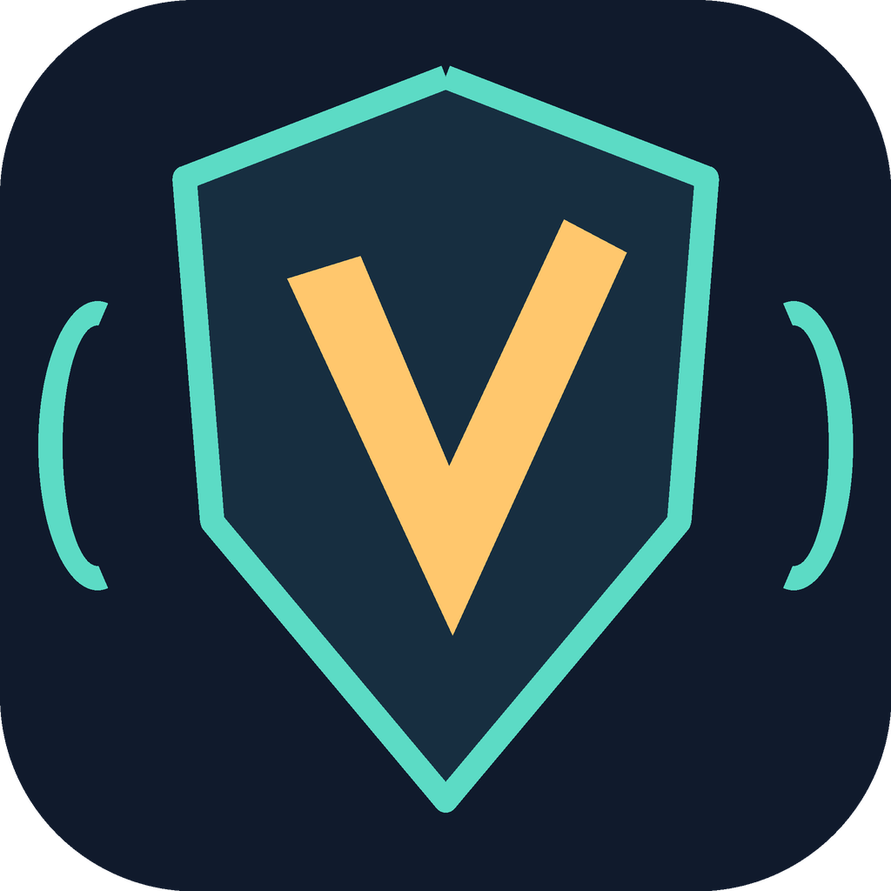

# Voxwarden



**Your voice. Your adventure.**

Voxwarden is David Rodriguez's independent AI companion for World of Warcraft: Forever. Ask by voice or text, get advice grounded in your character and local game knowledge, and see useful locations on your map.

This is a private development project. Public installers and a CurseForge listing will be prepared and published only when David chooses to release them. There are currently no Voxwarden public downloads.

## What it does

- Voice conversation with in-game Talk, microphone, pause, persona, Read and Tips controls.
- Per-chat model selection through a local subscription proxy or a configured API service.
- A local knowledge database for quests, NPCs, items, drops and prices, with sources and dates.
- Character-specific preferences and conversation memory; model statements stay separate from sourced facts.
- Advice about equipment, quest steps, dungeon loot, farming, repairs and full bags.
- Routes and pins on the world map. The AI gives advice; the player controls the character.

Text and game-content reasoning normally use Claude through the local subscription proxy. OpenAI Realtime handles speech and calls the reasoning service for game questions. Voice usage has separate API costs; a ChatGPT or Claude subscription does not pay for Realtime voice. Each user supplies their own accounts and credentials. The in-game model picker changes written chats; the voice reasoning model has its own configuration.

## Development and local checks

Node.js 22.19 or later is required. Install the locked development dependencies with `npm ci`. No personal configuration, keys, game databases or chat history belong in Git.

```powershell
npm test
npm run package:addon
```

The addon ZIP is written to `dist/Voxwarden-<version>.zip`. The ZIP contains the addon, its transport parts and the MIT notices. It does not include a user's brain database, other addons' data, credentials or the desktop application.

The desktop source is in `app/desktop`; its build configuration includes the brain and voice modules. Creating and signing installers, and validating them on each platform, are separate release tasks. An installed upstream application is not a Voxwarden release.

Existing development data can be migrated with the guarded local migration tool described in [the release preparation notes](docs/VOXWARDEN-RELEASE.md). Saved-variable identifiers and the wire protocol remain compatible, but the addon folder and desktop identity are Voxwarden's own. Never run both distributions against the same AddOns folder.

## Ownership, credits and licensing

Maintained by **David Rodriguez / davrodwconnections**. Voxwarden is an independent continuation of [NeverQuestAlone](https://github.com/tommygeoco/neverquestalone), itself based on [wow-ai](https://github.com/chelinho139/wow-ai).

The inherited code is MIT licensed. Its copyright and permission notices remain in [LICENSE](LICENSE); David's contributions are attributed there too. The Voxwarden name and original mark are documented in [branding/README.md](branding/README.md). Upstream names and artwork are not reused as Voxwarden's brand. See [CREDITS.md](CREDITS.md) for provenance and data boundaries.

Voxwarden is unofficial and is not affiliated with or endorsed by Blizzard Entertainment. Publication on an addon platform does not establish approval by Blizzard.
